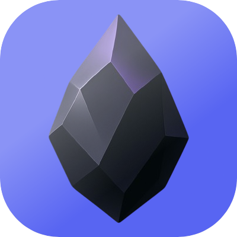
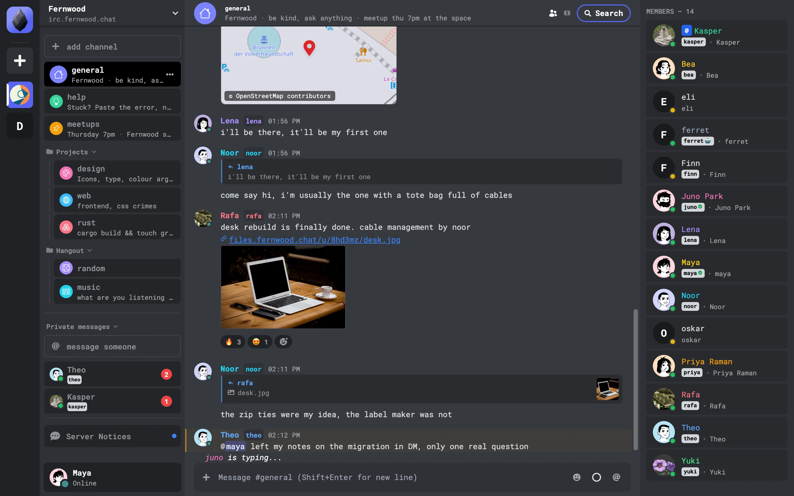
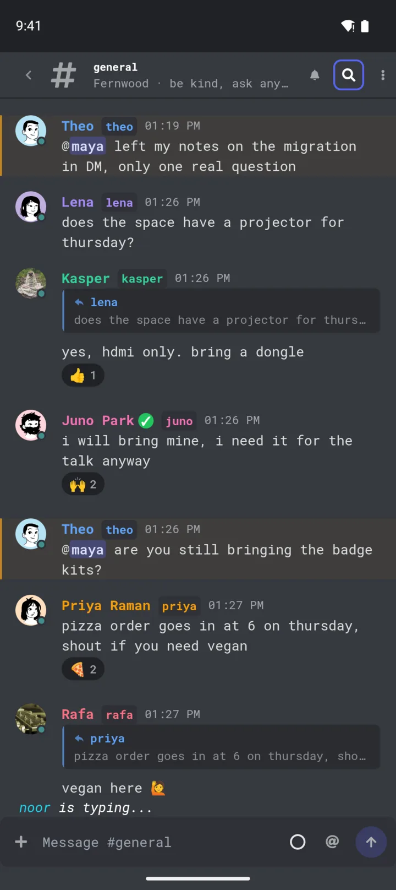
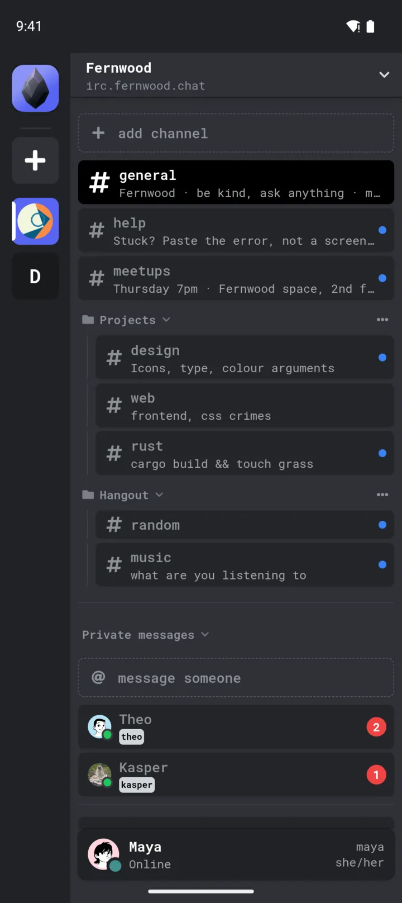
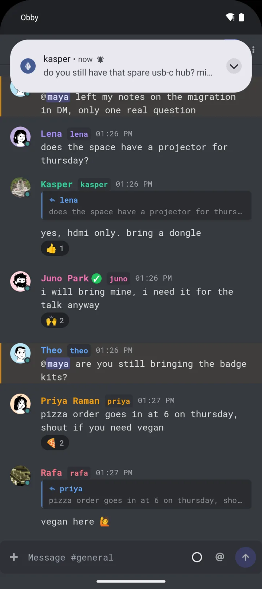
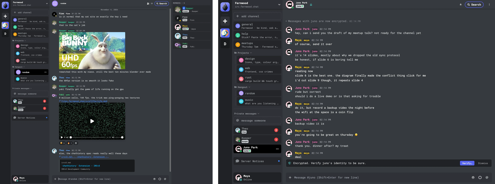

<div align="center">
  
  <h1>Obby</h1>
  <p>Obby is an IRC client for the web, desktop and phones. It gives any IRC network avatars, replies, reactions, encrypted DMs and searchable history.</p>

[](https://github.com/obbyworld/obby/releases/latest)
[](https://play.google.com/store/apps/details?id=com.obsidianirc.dev)
[](https://hub.docker.com/r/obbyworld/obby)
[](LICENSE)

**[Open in your browser](https://hello.obby.world)** · **[Download](https://github.com/obbyworld/obby/releases/latest)** · **[Google Play](https://play.google.com/store/apps/details?id=com.obsidianirc.dev)**

</div>



## Install

| Platform | Get it                                                                                                                                                                                          |
| -------- | ----------------------------------------------------------------------------------------------------------------------------------------------------------------------------------------------- |
| Web      | Open [hello.obby.world](https://hello.obby.world) in any browser.                                                                                                                               |
| Android  | Install it from [Google Play](https://play.google.com/store/apps/details?id=com.obsidianirc.dev).                                                                                               |
| macOS    | Download the `.dmg` from [Releases](https://github.com/obbyworld/obby/releases/latest). It runs on Apple Silicon and Intel.                                                                     |
| Windows  | Download the `.exe` installer from [Releases](https://github.com/obbyworld/obby/releases/latest).                                                                                               |
| Linux    | Run `yay -S obby` on Arch, or download the `.deb`, `.rpm` or AppImage from [Releases](https://github.com/obbyworld/obby/releases/latest).                                                       |
| iOS      | Install the `.ipa` from [Releases](https://github.com/obbyworld/obby/releases/latest) with [AltStore](https://altstore.io/) or [LiveContainer](https://github.com/LiveContainer/LiveContainer). |

The desktop app can self-update. See [INSTALL.md](INSTALL.md) for more options.

When Obby opens, pick a network from **Discover** or add your own server, then choose a nick.

## What you get

Obby is an IRC client that supports [IRCv3](https://ircv3.net), the modern IRC standard, plus a few [Obby extensions](https://github.com/obbyworld/extensions). It works with any IRC server and turns on each feature that the server supports.

Obby's own server is [ObbyIRCd](https://github.com/obbyworld/ObbyIRCd). It supports every feature in the list below, so run it if you want the full Obby experience for your community.

<p align="center">
  
  
  
</p>

- **Profiles:** avatars, display names and colors for people and channels, through [metadata](https://ircv3.net/specs/extensions/metadata).
- **Conversations:** [replies](https://ircv3.net/specs/client-tags/reply), [reactions](https://ircv3.net/specs/client-tags/react), typing indicators and message deletion.
- **Encrypted DMs:** [end-to-end encryption](https://github.com/obbyworld/extensions/blob/main/e2ee.md) between Obby users, and OTR with other clients.
- **History and search:** [chat history](https://ircv3.net/specs/extensions/chathistory) from the server plus a copy on your device, with [read markers](https://ircv3.net/specs/extensions/read-marker) that follow you across devices. Search filters by channel, sender, mentions and links.
- **Media:** previews for photos, videos, YouTube and [links](https://github.com/obbyworld/extensions/blob/main/link-preview.md). Obby loads media only from trusted hosts until you allow more, so a link someone posts can't reveal your IP.
- **Push notifications:** DMs and mentions reach you with the app closed. The browser uses Web Push, and Android uses [UnifiedPush](https://unifiedpush.org) with Google's push service or your own distributor, such as ntfy. The server needs `draft/webpush`.
- **Voice and video:** [voice and stream channels](https://github.com/obbyworld/extensions/blob/main/voice.md) with screen sharing.
- **Bots:** [channel bots](https://github.com/obbyworld/extensions/blob/main/channel-bots.md) with slash commands and forms.
- **Many networks:** several servers and accounts side by side, with channel folders.
- **[19 languages](src/locales).**



## Host it for your community

The web app ships as a Docker image. Point it at your server and share the link:

```sh
docker run -p 8080:80 \
  -e VITE_DEFAULT_IRC_SERVER=wss://irc.example.org \
  -e VITE_DEFAULT_IRC_SERVER_NAME="Example" \
  -e VITE_DEFAULT_IRC_CHANNELS="#lobby" \
  obbyworld/obby:latest
```

Then open http://localhost:8080. See [BUILD.md](BUILD.md#building-for-a-specific-server) for more options, such as a single-network client or OAuth sign-in.

## Build from source

```sh
git clone https://github.com/obbyworld/obby
cd obby
npm install
npm run dev
```

Then open http://localhost:5173. See [BUILD.md](BUILD.md) for the desktop and mobile apps, and [CONTRIBUTING.md](CONTRIBUTING.md) to run a local IRC server for testing.

## License

[GPL-3.0](LICENSE)
