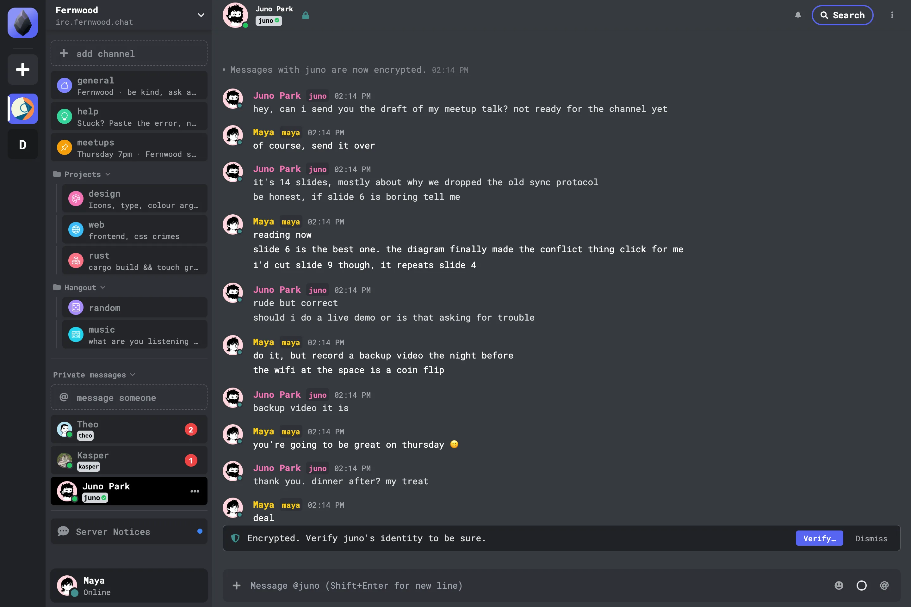

<div align="center">
  
  <h1>Obby</h1>
  <p>Obby is an IRC client for the web, desktop and phones that brings avatars, replies, reactions, encrypted DMs and searchable history to any IRC network.</p>

[](https://github.com/obbyworld/obby/releases/latest)
[](https://play.google.com/store/apps/details?id=com.obsidianirc.dev)
[](https://hub.docker.com/r/obbyworld/obby)
[](LICENSE)

**[Open in your browser](https://hello.obby.world)** · **[Download](https://github.com/obbyworld/obby/releases/latest)** · **[Google Play](https://play.google.com/store/apps/details?id=com.obsidianirc.dev)**

</div>


## Get Obby

| Platform | How                                                                                                                                            |
| -------- | ---------------------------------------------------------------------------------------------------------------------------------------------- |
| Web      | Open [hello.obby.world](https://hello.obby.world), no install                                                                                  |
| macOS    | `.dmg` from [Releases](https://github.com/obbyworld/obby/releases/latest) (Apple Silicon and Intel)                                            |
| Windows  | `.exe` or `.msi` from [Releases](https://github.com/obbyworld/obby/releases/latest)                                                            |
| Linux    | `.deb`, `.rpm` or AppImage from [Releases](https://github.com/obbyworld/obby/releases/latest), or `yay -S obby` on Arch                        |
| Android  | [Google Play](https://play.google.com/store/apps/details?id=com.obsidianirc.dev), or the `.apk` from Releases                                  |
| iOS      | The unsigned `.ipa` from Releases, through [AltStore](https://altstore.io/) or [LiveContainer](https://github.com/LiveContainer/LiveContainer) |

The desktop apps update themselves. [INSTALL.md](INSTALL.md) lists every file and the Linux dependencies.

Open Obby, pick a network from **Discover** or add your own server, and choose a nick. Obby connects over WebSocket in the browser and over plain TCP or TLS in the apps.

## Host it for your community

```sh
docker run -p 8080:80 \
  -e VITE_DEFAULT_IRC_SERVER=wss://irc.example.org \
  -e VITE_DEFAULT_IRC_SERVER_NAME="Example" \
  -e VITE_DEFAULT_IRC_CHANNELS="#lobby" \
  obbyworld/obby:latest
```

Then open http://localhost:8080. The container writes these settings into the page at start, so one image serves any network. [BUILD.md](BUILD.md#building-for-a-specific-server) lists the other options, such as `VITE_HIDE_SERVER_LIST` for a single-network client and OAuth sign-in.

## What it does

<p align="center">
  
  
  
</p>

- **Profiles:** avatars, display names, colors, pronouns and a status line (`draft/metadata-2`).
- **Conversations:** replies, emoji reactions, typing indicators, multiline messages and message deletion.
- **Encrypted DMs:** end-to-end encryption between Obby users, and OTR for people on other clients. The server only relays ciphertext.
- **History:** the server's chat history (`draft/chathistory`) plus a local copy on each device, with read markers that sync across sessions.
- **Search:** filter by channel, sender, mentions and links, then jump to any message in its context.
- **Many networks:** several servers and accounts side by side, with channel folders and per-channel notifications.
- **Media:** previews for images, video and known embeds. Obby only fetches links from trusted hosts until you allow external content, so a posted link does not reveal your IP.
- **Push notifications:** DMs and mentions reach you with the app closed, through Web Push in the browser and [UnifiedPush](https://unifiedpush.org) on Android (Google's push service or your own distributor, such as ntfy). It works on servers that offer web push (`draft/webpush`).
- **Voice and video:** voice channels with screen sharing on servers that run [ObbyIRCd](https://github.com/obbyworld/ObbyIRCd).
- **Bots:** slash commands with typed arguments and forms (`draft/bot-cmds`).
- **19 languages.**



Obby works with any IRC server. It reads what the server supports and turns on each feature that it finds. [ObbyIRCd](https://github.com/obbyworld/ObbyIRCd), a fork of UnrealIRCd, supports all of them.

## Build from source

```sh
git clone https://github.com/obbyworld/obby
cd obby
npm install
npm run dev
```

Then open http://localhost:5173. [BUILD.md](BUILD.md) covers the desktop and mobile apps and Nix. [CONTRIBUTING.md](CONTRIBUTING.md) runs a local IRC server for testing.

## License

[GPL-3.0](LICENSE)
